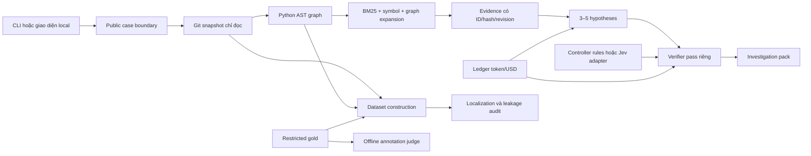

# Kiến trúc IssueIntel

Phase hiện hành (13/10/2026): [Strict DEV](STRICT_DEV_PROTOCOL.md) tách eligibility
khỏi artifact generation. `benchmarks.strict_dev` và `strict_dev_acquisition`
kiểm public provenance, source/reservations, opening query và snapshot-only;
không chạy graph/gold localization/LLM/evaluation. Release V2 bên dưới giữ nguyên
semantics cũ. Phase này chỉ kiểm đúng 400 Main Dev gốc và freeze N ≤ 400.
`main_dev_artifact_routing_v1` có cổng cohort Main Dev đã freeze và pilot trước bulk.

Milestone B: `benchmarks.dev_artifacts` replay/build deterministic graph, public
evidence và nhánh localization riêng; `benchmarks.dev_generation` đăng ký source,
policy và receipt theo stage chỉ trên accepted Main Dev. [DEV_ARTIFACTS.md](DEV_ARTIFACTS.md)
mô tả cổng pilot, stage exceptions, failure/resume và giới hạn nhãn.

## Pipeline chung

`investigation.claim_review` cung cấp `product_claim_review_v1`, source projection
riêng `claim_review_source_v1` và rubric `claim_sufficiency_v1`. Các trường raw
model reviews được giữ riêng với assessment tái tính; validator tái dựng để chặn
sửa kết quả rồi rehash. Quote của claim khớp nguyên văn statement; quote support,
counter và assumption khớp evidence đúng SHA/revision. Offset theo Unicode code
point, đầu gồm/cuối không gồm; không tự map ID hay sửa quote. Mỗi hypothesis có
đúng một review, 0–4 claim không chồng nhau; phần câu chưa được phủ vẫn hiển thị.
Code kiểm citation riêng với applicability/inferential-link do model nhận xét.
Thiếu exact support thì unsupported; thiếu applicability, mắt xích cơ chế/hành
vi, code cho suy luận hoặc còn unverified assumptions thì uncertain. Counter
không rõ ngữ cảnh/căn cứ cũng không được coi contradicted. Causal support giữ
uncertain khi không có proof thực thi độc lập. Mọi semantic/causal/human flags
vẫn unverified/false; kết quả không phải nhãn người hay đánh giá chất lượng.

`source_jobs.SourceJobs` là runner chung cho hai adapter cụ thể CheckPlanJobs và
ClaimReviewJobs: giữ nguyên DB/path/request contract của check plan, dùng DB/
result key riêng cho claims. Durable intent khóa source job + pack SHA, một target
kể cả lỗi/restart. Trước provider phải replay Git snapshot; trước mỗi call/output
repair kiểm lại product authority và source bindings; mỗi call giữ receipt owned stage. Tối đa một
output repair; lỗi transport/admission và cancel không tạo paid retry. Đọc/export
không reacquire Git, load API config hay construct provider. Claims được thêm vào
dossier/handoff bằng nguồn đã replay; portable verifier kiểm owner/quote bindings
trên included bytes, không đánh giá ngữ nghĩa. API/UI tách claim sidecar khỏi
whole-hypothesis critique cũ và không rewrite generation/verifier/report v1.

`investigation.handoff.Handoffs` xuất một selection riêng từ dossier đã replay,
giữ pack bytes/report bindings, tự thêm ancestry và chỉ lấy checkpoint recovery
được con tham chiếu. Không sao chép folder job, database, `.env` hoặc Git cache.
Preview khóa dossier, lựa chọn, SHA ZIP và dung lượng; export tái dựng deterministic
ZIP rồi so đúng preview. Source/journal đổi thì từ chối. HTTP POST giữ session/
Origin guards; browser kiểm header, byte size và SHA256 trước download, chặn stale.
HTML tĩnh escape nội dung, CSP không script/network; giữ cảnh báo chưa kiểm hash.
`portable_verify.py` dùng thư viện chuẩn, được chép vào ZIP làm `verify.py` và
dùng chung bởi CLI `verify-handoff` (không load env). Verifier không extract hoặc
execute bundle, giới hạn 512 file/100 MB, từ chối path/link/duplicate/entry lạ,
kiểm manifest, nguồn report/pack/excerpt/ancestor/recovery. Kết quả chỉ khẳng định
included-byte consistency, không full Git replay, authorship hay semantic truth.
SHA ZIP phải trao qua kênh tin cậy nếu cần đối chiếu bên gửi; manifest tự hash
không phải chữ ký. Private bundles ở ignored artifacts/downloads, không vào CI.

`investigation.pipeline.investigate()` là application entry point. Nó nhận case công khai và repository đã chọn revision; không đọc gold, human rationale hoặc nhãn tham chiếu. Dataset preparation dùng cùng `build_snapshot()` và `build_graph()`, rồi mới tạo localization ở nhánh riêng.

Workbench bổ sung intake, follow-up, so sánh, truy xuất lịch sử và checklist qua
shared modules trong `investigation`/`retrieval`. Follow-up có lineage pack hash,
giữ commit và tạo query mới unverified. Related search chỉ tham khảo lịch sử local,
không nhập vào strict inference. `investigation.plan.PlanStore` dùng SQLite local
riêng cho user-reported checks, hash chain và optimistic concurrency; không dùng
PostgreSQL hoặc sửa benchmark receipts. Interface chỉ render và gọi các service.

`investigation.check_journal.CheckJournalStore` lưu manual observations trong
table riêng cùng DB checklist, giữ nguyên plan v1. Check IDs lấy từ
`InvestigationReport.next_checks` đã dedup, không ánh xạ theo vị trí `step_N`
của checklist. Mỗi event khóa report/pack/query/snapshot/job, text SHA và đúng
hypothesis/evidence IDs do server lấy; recorded_at là lúc ghi, không proof chạy.
Full SHA người dùng tự báo đã thử giữ riêng commit phân tích, không resolve Git
hoặc mặc định bằng source SHA. Outcome là not_run/inconclusive/reported_match/
reported_difference; không chuyển thành semantic/causal/fix verification hoặc
independent human labels. Correction append-only cùng check, trỏ về record chưa
bị supersede; mọi record cũ còn trong export. `BEGIN IMMEDIATE` và expected SHA
chặn ghi đè/gửi lặp cùng phiên bản; giới hạn 100 event mỗi journal. Replay kiểm
schema/type, source/check bindings và toàn chuỗi, không xác thực danh tính tác
giả hay bảo đảm chống người kiểm soát toàn DB viết lại lịch sử. Workbench replay
product authority xuyên follow-up/context/resume, cấm benchmark/strict trước
đọc hoặc ghi journal. Read/export không lấy Git/network/model, không sửa nguồn.
JSON journal và Markdown report+journal có header report SHA và journal SHA;
UI kiểm cả hai khi tải để không xuất nhầm revision. Observations không tự đi
vào inference, GitHub draft hoặc dataset; pack/report v1/receipts giữ nguyên.

`investigation.report` tạo projection `investigation_report_v1` có JSON Schema
riêng từ pack đã lưu và SHA256 của đúng bytes nguồn. Projection không đọc Git,
network, gold hoặc gọi model; Workbench replay export và lineage trước khi dựng.
Web Overview, Markdown và nháp GitHub dùng cùng fields/citations/truth levels.
`execution.status=completed` chỉ nói lượt điều tra đã hoàn tất; model critique
không chuyển `causal_status` hoặc semantic support sang verified. Severity giữ
unassessed, confidence probability giữ null, checks giữ not-executed. Excerpt
có hash riêng và dấu truncated; link code chỉ dùng repo khớp issue, commit đầy
đủ và line range. Report có digest riêng, không nằm trong inference pack.
Standalone CLI export thêm `report.json`; đọc pack cũ chỉ derive view, không sửa
pack/report.md/receipt. API tải Markdown mới tách khỏi route legacy đã lưu.
Nháp GitHub thu gọn có giới hạn, báo rõ chi tiết bị bỏ và vẫn duyệt đúng body SHA.
Schema được kiểm bằng jsonschema trong dev/CI; runtime chỉ dùng thư viện chuẩn.

`investigation.hypothesis_review` dựng `hypothesis_review_v1` thuần dữ liệu từ
report đã qua `validate_report`, giữ report SHA cùng toàn bộ source binding.
Mỗi hypothesis giữ support/counter, model review, check IDs và gap codes từ
metadata được ghi: chưa có counter trong phạm vi truy xuất, chưa có citation
code hỗ trợ hoặc model review thiếu/unsupported/contradicted/uncertain. Cặp giả
thuyết dùng giao ID theo thứ tự evidence gốc để lộ nguồn hỗ trợ/phản bác dùng
chung và citation khác vai trò. Không gộp các ID khác nhau chỉ vì nội dung giống,
không suy ra quan hệ nhân quả, phụ thuộc, độc lập hoặc mâu thuẫn ngữ nghĩa.
Validator tái dựng projection từ report và so toàn bộ để chặn sửa rồi tính lại
hash. UI đọc cùng lượt mở saved job, cache khi đổi ngôn ngữ và chặn citation/
download stale theo job/report/pack/query/snapshot. JSON/Markdown HTTP mang
`X-IssueIntel-Report-SHA256` từ chính projection được gửi. CLI export sidecar;
đọc bản cũ không tạo/sửa pack, report hay receipts. Không có Git/network/model,
evaluation hoặc xếp hạng chất lượng trong lớp đối chiếu này.

`investigation.clarifications` giữ template v1 Việt/Anh cố định cho bốn mục intake;
không gọi model. Workbench khóa parent pack/query/question bundle, lưu nguyên Q/A
theo ngôn ngữ đã xem và replay receipt khi đọc/export. Chỉ product và các hậu duệ
product được dùng; request authority được kiểm xuyên follow-up/context/resume,
không dùng benchmark dù follow-up đã bỏ nhãn strict. Trước provider phải replay
snapshot descriptor và excerpt từ Git ở đúng SHA. Query mới lấy code lại, không
kế thừa context repository đang khóa query cũ, quyền đăng GitHub hay checkpoint
verifier. Tám thế hệ dùng chung với follow-up/context. Câu hỏi tự sinh bị loại
khỏi lexical cues: intake lưu projection nội dung người dùng, hash và nguồn dòng
riêng; query SHA vẫn khóa toàn bộ đầu vào. “Có cue” và “đã trả lời” không chứng
minh thông tin đầy đủ/đúng. Template v1 phải được giữ để replay artifact cũ.

`investigation.finalization` và `finalization_jobs.FinalizationJobs` phục hồi
export khi generation/verifier product Quick/Deep đã lưu nhưng job thất bại,
ngắt hoặc bị hủy. Service xác thực source request, stage paths/bytes/SHA,
canonical type/schema và policy trước khi nhận, trong worker và trước publish.
Assembly dùng `finish_pack` với annotation và verifier nguyên vẹn; không gọi
provider, đọc config/API key hoặc truy cập Git. Snapshot chỉ replay descriptor
đã lưu, receipt ghi `full_git_replay_performed: false` và 0 call mới. SQLite
intent khóa một child cho mỗi source, enqueue/cancel dùng queue chung; export
sang child directory mới và không sở hữu stage/usage receipts của nguồn.
`finalized_from` khóa source request, hai raw stage SHA, prepared/verifier
payload và policy; mọi lần đọc dựng lại pack dự kiến rồi so toàn bộ digest.
Admission dùng policy hiện tại, bản đã hoàn tất dùng policy được ghi, không
recertify theo code mới. Product authority traversal không đòi pack nguồn đã
export; benchmark/Planned/follow-up và quyền GitHub write không đi qua luồng này.

`investigation.dossier.Dossiers` dựng timeline từ các product jobs cùng định danh
issue, kiểm original request với original case/stage và replay từng report trước
khi đưa vào hồ sơ. Jobs chưa xong chỉ là metadata, nguồn lỗi được ghi rõ; Main
Dev/strict và lineage benchmark bị chặn. Mỗi transition giữ hai pack/report
bindings và receipt quan sát lịch sử của child, so nhãn A/B với dự đoán saved
plan; commit không biết/khác commit và later correction vẫn tách riêng. Không
suy ra semantic correspondence từ ID giống nhau. Liên kết giả thuyết do người
dùng ghi vào `dossiers.sqlite` với exact evidence refs, lý do, hash chain và
expected SHA; correction append-only, mọi truth flags vẫn unverified. Đọc/xuất
không dùng Git/provider/config; source hay policy benchmark không bị sửa.

`investigation.adaptive_clarifications` thêm câu hỏi riêng dựa trên public issue,
evidence và hypotheses đã lưu, với prompt v1/hash và bilingual structured output.
Mỗi câu trỏ tới ít nhất hai hypothesis ID và một code citation; validation kiểm
reference/schema/hash, không xác nhận chất lượng phân biệt hay causal truth.
`question_jobs.QuestionJobs` dùng queue và receipt accounting chung; trước
provider replay snapshot/excerpts, khóa source pack/query/annotation/evidence.
SQLite intent giữ một attempt cho mỗi source job+pack SHA, kể cả failed/cancelled;
không auto retry, repair, regeneration hoặc resume. Bundle private tách khỏi
pack gốc, đọc lại dùng saved source, không mutable index/model. Adaptive answers
có schema riêng, giữ nguyên prompt/purpose/answer-use/IDs; lineage replay cả
question job và parent. Tám thế hệ và các cổng product-only giữ như template.

`retrieval.repository_context` có local search và explicit collector: 1–6 nguồn
khóa record+receipt SHA/global repo ID, không auto-expand. Context mode của
Workbench chỉ nhận parent GitHub product, replay parent pack/snapshot trước
provider, giữ query và commit, và tạo `context_selection` lineage hash-bound.
Preview/inference dùng cùng issue query để cắt excerpt; từ khóa tìm kiếm chỉ chọn
ứng viên. Read/export replay saved records/receipts không consult mutable index.
Giới hạn tám thế hệ đi chung với follow-up, context mode không được resume paid
verifier hoặc kế thừa GitHub write approval.

## Quyền sở hữu của các package

| Package | Trách nhiệm | Ranh giới |
|---|---|---|
| `repository` | Nhận GitHub URL/local Git; đọc Git objects; AST; cache blob có hash | Không checkout, import hoặc chạy test/code của repo đích |
| `retrieval` | BM25/identifier, loại chunk trùng, mở rộng cạnh typed có giới hạn | Điểm liên quan không phải xác suất đúng |
| `investigation` | Hypotheses, controller, critique, investigation pack | Chỉ public evidence; không gold judge |
| `annotations` | Schema, sinh nhãn, synthetic variants, blind review; judge tách riêng | Provenance LLM/synthetic/source-human/human riêng biệt |
| `benchmarks` | Pin/import nguồn; projection; temporal audit; asset/annotation workflow | Gold chỉ ở dataset construction/evaluator; default dev |
| `evaluation` | Metric localization và capability đọc holdout theo release | Cần ủy quyền evaluation mới; file patch là proxy, giữ file ngoài snapshot trong mẫu số |
| `runtime` | Cấu hình, hash, ghi atomic, sổ ngân sách SQLite | Thiếu limit/key/price thì từ chối; không có unlimited ngầm |
| `interfaces` | CLI gọi application code | Không nhét logic truy xuất/gán nhãn vào giao diện |

## Snapshot và provenance

Snapshot chứa commit, tree, Git blob OID, SHA256 raw bytes/canonical text, protocol, cutoff, skipped files và hash toàn snapshot. Cat-file batch đọc các blob trong một tiến trình, giới hạn 10.000 file, 512 KB/file và 25 MB/source snapshot. Symlink, submodule, binary, encoding lỗi và phần vượt giới hạn đều có lý do bỏ qua.

Graph có node file/class/function; cạnh contains/imports/inherits/calls. Quan hệ call tĩnh là suy luận từ syntax, không chứng minh hành vi runtime. Dynamic dispatch và tên mơ hồ giữ unresolved. Graph phải khớp revision/hash snapshot; snapshot được truyền vào pipeline phải khớp case và protocol.

Retrieval chỉ trích các dòng nguyên vẹn trong giới hạn excerpt; dòng vượt giới
hạn không bị cắt giữa dòng rồi gắn locator của cả dòng. Excerpt rỗng bị bỏ qua,
và phần còn lại giữ đúng start/end để replay với snapshot. Không thay hash của
artifact cũ khi thay đổi quy tắc retrieval; recipe cũ vẫn phải qua integrity gate.

Cache giữ text theo SHA256 trong blob gzip dùng chung; index snapshot và graph nén. Investigation pack chỉ chứa code excerpts và metadata liên quan, không chép toàn repository. Có thể rebuild derived cache từ nguồn, nhưng phải kiểm receipt/inventory trước khi coi một ca hoàn tất; không thay hash mong đợi để che lỗi.

## Temporal và gold isolation

Product repository memory nằm riêng trong `integrations.github_index`:
`RepositoryIndex` đồng bộ REST read-only có page receipts/cursor transaction,
global repository ID và OS writer lock; lưu private SQLite/FTS5, snapshot/graph
theo hash. CLI và workbench gọi cùng service cho sync/status/search/item;
sync jobs dùng chung queue/capacity nhưng giữ lịch sử riêng với investigation.
Progress/cancel kiểm tại ranh giới stage/page; ngắt không xóa page đã commit.
UI hiển thị source/scan/commit riêng với controls và hỗ trợ Việt/Anh, sáng/tối.
Refresh đối soát
thủ công; dữ liệu current REST không được đưa vào benchmark pipeline hoặc
coi là historical proof. Không lưu patch/diff, không gọi model. Xem
[REPOSITORY_INDEX.md](REPOSITORY_INDEX.md) về coverage/caps và replay.

`integrations.github_sync` giữ connection lifecycle private trong SQLite;
scheduler workbench chia đợt 20 GET trên cùng queue để tự hoàn tất initial scan.
`repository_updates` xác minh HMAC trước JSON, bind App/installation/repository
global ID, dedup delivery và đọc lại REST canonical theo event. Page receipt,
cursor và mutation index commit cùng transaction. Unavailable records giữ audit
và bị loại khỏi search; PR membership thay đổi chỉ đối soát khi listing không
chạm cap. Push resolve tracked ref hiện tại, không dùng event cũ để rollback.
Network/rate-limit có cooldown qua restart; identity/integrity lỗi tạm dừng.
Stop server giữ phase tự động; pause của người dùng giữ riêng và resume đối soát.

`retrieval.repository_context` lấy tối đa 6 nguồn/7.200 ký tự excerpt từ repo đã
kết nối, ưu tiên linked records rồi lexical hits. `record_links` phân biệt text
mention chưa xác minh, comment membership và PR–file/commit do API trả về.
Pipeline replay source/receipt/query bindings trước model; full source records
chỉ ở pack private, model projection nhận excerpts. Context luôn current,
`available_at=None`; bị chặn với split benchmark, strict và prepared evidence.
Comparison và comment preview giữ nguồn/hash/links của context đã chọn.

Hai protocol: `benchmark_base` đọc base_commit của upstream và khai báo thời gian chưa xác minh; `issue_time` từ chối nếu không có receipt xác minh đúng revision với `available_at < issue_created_at`. Hash đúng không chứng minh lịch sử đúng. Receipt authenticity thuộc trách nhiệm caller; audit lưu giới hạn này.

Target issue là truy vấn tại thời điểm mở nên có ngoại lệ `<=` cho original title/body. Nội dung API hiện tại và `updated_at` không đủ chứng minh body ban đầu. Human notes, patch, test_patch, test IDs, hints và metadata evaluation không đi vào prompt public. Gold localization chỉ trích file/dòng phía base/symbol từ unified diff; insertion có anchor riêng, added file không bịa pre-patch symbol.

`benchmarks.asof` chuẩn bị receipt lịch sử, còn `asof_assets` replay receipt trước khi xây snapshot `issue_time`. Base nguồn giữ nguyên; selected ancestor phải có ancestry và public availability riêng. Query ban đầu nằm trong overlay có parent/hash, không sửa case nguồn. GitHub opened event và Trac version 0 có adapter riêng. Nhãn người của query nguồn không tự áp dụng cho overlay.

`benchmarks.construction` đăng ký recipe trước call và lưu các stage generation/critique/judge/variants riêng. Hash dependency theo protocol: thay đổi validator lịch sử chặn strict resume; code generation chung chặn cả hai protocol. ZIP source/config của registration giữ hash của lần chạy. Preparation/annotation construction có thể tạo asset/nhãn holdout theo recipe, nhưng không mở evaluation capability, tính metrics hoặc tune model.

`benchmarks.releases` chốt các ca đủ proof và đủ bốn stage, giữ exclusions và archive của recipe. `evaluation.open_test_split` nhận release có hash cùng ủy quyền/purpose mới; capability đọc đúng cohort đã chốt, replay integrity mỗi lần đọc và hết hiệu lực khi rời context. Cổng bootstrap cũ vẫn giữ dữ liệu Live chưa xác minh ở trạng thái bị chặn. Các module này không gọi model hoặc tự chạy metrics.

`benchmarks.cohorts` tạo view cho extension Live có parent/source/selection hashes, tách cases/eligibility/restricted gold. View yêu cầu lựa chọn rõ ràng, không đổi default dev/test loaders hoặc nguồn bootstrap. Historical và annotation builders chỉ nhận namespace được hỗ trợ bởi phiên bản code/recipe tương ứng; không truyền ID ngoài manifest để lách kiểm.

## Controller và verifier

`investigation.discriminating_checks` có output contract cho kiểm tra đề xuất:
procedure/assumptions, outcomes A/B, predictions đầy đủ cho 3–5 hypothesis và
code citations hợp lệ. Selector đếm cặp có prediction A/B khác nhau, bỏ unknown,
rồi dùng model-estimated effort làm tie-break; tất cả giữ unreviewed/unverified.
Không gán xác suất, chạy check hoặc chứng nhận causal correctness. Khai báo
outcome khác nhau về label chưa chứng minh phân biệt về ngữ nghĩa.

`investigation.policy_agent` cung cấp chung bounded search_code/read_code trên
snapshot đã replay cho hai chính sách prompt. Seed/context, schema và budgets
giống nhau; action chỉ đọc tối đa 60 dòng/4.000 ký tự, ba round. Error/repeated
request vẫn tiêu hao round; final call tối đa 16.384 output tokens. Protocol v10
dành một repair slot cho final, tối đa năm call kể cả repair. Các stage dùng effort
medium; cả hai policy cùng cấu hình. Chỉ output lỗi được
sửa bằng một request mới từ context/schema gốc; auth/rate/network/budget và lỗi
integrity ở call store không đi vào repair. Record cũ giữ nguyên, không bịa hoặc
ánh xạ lại citation/path. Ranked paths chỉ thuộc file đã đọc/truy xuất; schema
và local validator cùng kiểm enum, độ dài và đủ prediction. Action/final dùng
instruction riêng, final không còn danh sách tool/file index mời gọi hành động.
`benchmarks.policy_pilot` preregister 25 accepted original Main Dev cùng source/
query/snapshot/code/config hashes và thứ tự arm luân phiên.
JSON payload được canonical hóa trước hash/HTTP, nên key order trong response
đã lưu không làm đổi request ở stage tiếp theo khi replay. Call intent giữ request
hash và receipt ownership trước HTTP, response được giữ trước validation. Resume
replay bằng saved calls, cấm tạo call thay thế khi receipt/output bị thiếu.
Action và final dùng constrained `json_schema`, `strict:true`, schema đầy đủ
đặt trong response_format; không thêm native tools/tool_choice/parallel_tool_calls.
Planner được yêu cầu phân loại catalog entry thay vì sinh command. Schema choice_id
chỉ nhận STOP hoặc R1…/S1…, cùng reason; không có raw query/range field. R ID ánh xạ chính xác
về locator đã tính, không ánh xạ output sai về một file hợp lệ. Raw proposal được
giữ trong action record và replay cùng catalog/hash; local schema/semantic guard
từ chối ID lạ và field thừa. Code vẫn kiểm bounds trước search/read.
Provider từ chối native tool_calls ngay cả khi có JSON content. Catalog cho tối đa
12 locator hợp lệ, chưa dùng, mỗi locator tối đa 500 ký tự, tính từ file trong
evidence hiện tại. S ID chọn trong tối đa 24 query đã loại trùng/đã dùng, sinh từ
identifier/camel-case/underscore trong issue, class/def names trong evidence và
từ khóa dài; heuristic không đọc gold/human rationale hoặc tạo bằng chứng mới.
Model không được đặt query/range tùy ý; search vẫn tìm toàn snapshot và có thể
cung cấp file mới cho round sau. Hai policy có cùng menu/rules; đây là phạm vi
controller có catalog, không có quyền chọn query tự do như harness ban đầu. Lịch sử
trước lựa chọn giữ ID, locator/query, status/failure và evidence IDs thay vì mời
model gọi function. Không cắt yêu cầu đọc sai để làm thành công. ToolRequestError trả mã lỗi
riêng cho range/EOF/character bound/path/empty/repeated request vào past_actions,
để planner có thể sửa ở round tiếp theo; lỗi snapshot/retrieval không bị che thành
lỗi argument. Planner có output không hợp lệ thì chuyển ngay
deterministic finish với `controller_degraded`/failure trace và không execute
proposal sai. Final vẫn phải qua tất cả validation; không synthesize success.
Final dùng cùng strict schema, đóng phase tool; payload gộp thành một user
message. Canonical findings_schema vẫn giới hạn năm ranked_paths duy nhất.
wire_findings_schema thay mảng path bằng file_preferences object đóng, mỗi P ID
khóa vào một file evidence, giá trị rank_1…rank_5/omit. Groq đã từ chối uniqueItems
ở control v8 nên wire không dùng keyword này; local validator vẫn kiểm uniqueness.
project_findings kiểm toàn bộ wire rồi sắp theo mức ưu tiên và thứ tự catalog đã
lưu khi đồng hạng, lấy tối đa năm file và chạy validate_findings đầy đủ. Không
nhận danh sách path lỗi để tự loại trùng/ánh xạ; ID lạ, key thiếu/thừa hoặc giá trị
sai bị từ chối. Result giữ candidate catalog, raw preferences, các nhóm đồng
hạng và rule ở ranking_projection; đây là quy tắc ưu tiên tương đối, không phải
thứ tự model phân biệt hết hay confidence/causal truth. HTTP status, allowlisted
error code, retry-after hữu hạn và classification được lưu; không lưu message,
response body hoặc key vào error metadata. Saved terminal output errors được
phát lại như exception để đi vào đúng repair stage đã ghi, không gửi lại HTTP.
Ca đầu cần hai arm hoàn tất trước full diagnostic. Provider/storage errors dừng;
output failure sau repair ở ca sau giữ denominator và không retry. Separate scorer chỉ
đọc exact DEV patch rows sau sealed inference; localization là file proxy gồm
unavailable files. Không chạy holdout capability, đọc Live, nới strict contract
hoặc sửa artifact/receipt cũ. Human/semantic check scoring giữ unreviewed.
Lỗi integrity hoặc runtime ngoài output rejection cũng dừng cả runner. Stop reason
được giữ trong arm record và kiểm lại khi resume, nên một failed arm không thể
bị bỏ qua để tiếp tục gọi trả phí ở arm khác sau lỗi receipt/request binding.
Mode reliability regression đăng ký bốn ca đã accepted từ parent sealed,
replay proof/source hiện tại và giữ bindings parent. Chỉ kiểm lỗi output, không
đọc gold/scorer; selection theo lỗi cũ không phải thí nghiệm chất lượng độc lập.
Không có bulk rerun tự động. Regression chỉ mở gate sau hai arm đầu hoàn tất
mà không degrade/repair/invalid action. Summary đếm failed call records, repair
records và invalid/repeated tool actions riêng với valid final reports.
clean_regression yêu cầu tám arm, inference sealed và mọi bộ đếm lỗi bằng 0;
hai lượt ổn định phải dùng hai registration mới cùng fingerprint, không retry
stage trả phí. Khác transport/search/read scope/ranking contract/budget được ghi trong spec v10; bundle cũ
cần đúng source archive cho replay, report đã lưu vẫn đọc độc lập.

`investigation.evidence_graph` là view của báo cáo đã lưu, khác với AST graph.
Replay query/hash/citation/context bindings và validate critique trước khi chiếu
ra query, hypotheses, evidence và model reviews. Quan hệ truy xuất, asserted
support/counter, assessment và critic citation giữ riêng; không nâng thành causal
truth/human validation. Giao diện SVG có keyboard/inspector/filter và mở citation
về đúng job. View tối đa 100 nút, 300 cạnh, 8.000 ký tự/nút, đếm phần lược bỏ và
không giữ cạnh trỏ ra ngoài view. Workbench bind thêm job/pack SHA256; không sửa
pack gốc, gọi model, xây code graph mới hoặc mở evaluation.

`investigation.versions` đối chiếu hai snapshot trong cùng repository, replay
descriptor/hash/excerpts của báo cáo nguồn trước khi đọc target. Chỉ original
product case dùng benchmark_base ngoài mọi split; follow-up/strict/benchmark bị
chặn. Workbench chạy job riêng trong cùng queue, có cancel và export hash-bound
về source pack; không sửa pack/citation/eligibility. Đếm mọi tracked text được
snapshot nhận, giữ skipped là unavailable; hiển thị tối đa 200 mục và bốn diff
file evidence (2.000 dòng/40.000 ký tự input và 12.000 ký tự output mỗi diff).
Không chạy test, gọi LLM hoặc xác nhận bản sửa/release.

`investigation.reachability` bổ sung ancestry view của cùng repository product.
Resolve ref một lần về SHA, so source/target hai chiều, tùy chọn kiểm commit tham
chiếu và tối đa 200 tag local chụp cùng OID. Không checkout/hook/lazy-fetch;
replacement/commit-graph bị tắt, graft được bỏ qua và đánh dấu altered. Kết quả
âm tính thiếu lịch sử giữ unknown; không gán tag Git thành published release.
Giới hạn thời gian/output và callback cancel áp dụng giữa lệnh. Workbench pin
reference fetched riêng về SHA trước inspection; hash nested result và source/
target/reference được kiểm lại khi đọc export, không chạy lại Git hoặc model.

Rule workflow là baseline cố định. `JevController` nhận state cùng allowed actions,
chỉ trả enum hợp lệ; hành động khác fallback về rules, với cờ fallback quan sát
được. Code vẫn giữ quyền kiểm ngân sách và thực thi; model không chạy command.
`typesafe_controller.TypesafePlannedController` nối riêng API Typesafe cho product
Planned có Groq. Mỗi decision khóa query/snapshot, annotation và inventory nguồn;
state chỉ chứa issue/hypothesis/evidence excerpt rút gọn có cờ truncation, cùng
counts/gaps quan sát. Request một Choice với đúng action allowlist, không gửi
toàn repo, gold hoặc source quality. Tối đa bốn decision, không ảnh hưởng cận
generation/critic của plan v1. Sidecar `typesafe_controller_v1` khóa plan SHA,
job, request, response và receipt; replay thuần dữ liệu đối chiếu decision vào
seed/round/final state, không mạng/model/ledger và không suy ra causal truth.
Workbench còn kiểm receipt ownership với job, từ chối sidecar thiếu/đổi nguồn.

Verifier kiểm hash/ID trước. Pass LLM riêng kiểm support/counter và trả assessment có citation; đây là critique của cùng model khi dùng cùng provider, không được gọi là kiểm người độc lập. Semantic correctness và causal truth vẫn phân biệt. Khi citation sai, generator chỉ được sửa schema một lần với allowlist; lỗi budget/network không được tự retry.

Product Deep có `refinement_rounds=1`: controller chọn retrieve/verify/stop sau
seed generation; `retrieval.focused` chạy tối đa ba query/sáu excerpt trong chính
snapshot đã kiểm. Hit replay bytes/range/revision và không trùng/overlap. Chỉ có
hit mới mới cho sinh lại, rồi chuyển sang verify/stop với zero rounds remaining.
Không nhập history/gold và không nới as-of proof; prepared evidence đã freeze
không được mở rộng. Mặc định pipeline/CLI vẫn zero rounds cho baseline.

Product Planned là lựa chọn riêng `planned_workflow=True`, Web `depth=planned`,
CLI `--planned`; không kết hợp Deep, strict, benchmark case, prepared evidence
hoặc resume. `investigation.planner` định tuyến bằng dấu hiệu quan sát được từ
seed (file, missing counter, parse/skipped gaps), khóa budget một đến ba vòng.
Pipeline dùng controller typed retrieve/verify/stop; tối đa ba query/sáu excerpt
mỗi vòng và 18 excerpt mới tổng cộng. Hash query được khử trùng cả trong/vượt
vòng, kể cả query issue gốc; span/ID evidence không lặp. Không có hit mới thì
không sinh lại. Tối đa bốn lượt generation (mỗi lượt một schema repair) và một
critic, tức chín provider calls. Rules vẫn là mặc định; không gọi Jev tự động.
`planned_investigation_v1` lưu seed, annotation/evidence chain, query/search,
controller/fallback, routing, giới hạn, counts và stop reason; validator replay
liên kết query/snapshot/run ID và hash trước saved-read/report. Không suy ra
causal truth hoặc độ khó đã hiệu chỉnh từ route. Plan và checkpoint không cấp
quyền thực thi tool/code hoặc benchmark evaluation. Các stage cố định
`planned_input`, `planned_retrieval_1..3`, `planned_generation_1..3`,
`planned_complete` giữ tiến độ khi lỗi; receipt chi phí gắn đúng stage.

`investigation.stages` ghi checkpoint private sau từng stage đã hoàn tất, giữ
seed khi stage sau lỗi; không overwrite, không retry hoặc tự resume paid calls.
WorkBench/CLI cung cấp callback lưu, pipeline chịu trách nhiệm nội dung và
thứ tự. Các checkpoint này không phải benchmark receipts hay kết quả evaluation.

`investigation.resume` replay `verification_input` của product Quick/Deep: khóa
query/snapshot, replay bytes/citation và annotation, so policy SHA từ source code,
rồi chỉ gọi verifier. Main Dev/strict/follow-up bị chặn. Workbench GET resume chỉ
preview; POST yêu cầu exact checkpoint SHA và xác nhận chi phí. SQLite intent
`BEGIN IMMEDIATE` khóa một child cho mỗi source; worker kiểm intent durable và
source lại trước provider. Giữ nguyên source job/receipts, child có checkpoint
verification và receipt riêng; export liên kết source bằng hash. Một verifier đã
hoàn tất không được gọi lại theo luồng này. Không tự phục hồi hoặc retry API.

## Ngân sách và bảo mật

`investigation.check_plans` tạo phần bổ sung `product_check_plan_v1` cho báo cáo
product có giả thuyết đã lưu. Nó dùng chung public source projection với câu
hỏi thích nghi, thêm report SHA; không sinh lại giả thuyết hoặc đổi report v1.
Output chỉ gồm 0–3 kiểm tra với procedure/controls/A–B/effort/citations và đúng
một dự đoán A/B/unknown cho mọi giả thuyết. Validator đóng schema, kiểm đầy đủ
refs/bounds/A–B khác nhau; `discriminating_checks.compare_proposed_checks`
chọn nhiều cặp A/B do model nêu nhất, rồi effort/thứ tự lưu. Số cặp này không
phải information gain, chất lượng ngữ nghĩa hoặc xác nhận nguyên nhân.

`check_plan_jobs.CheckPlanJobs` khóa intent SQLite theo source job + pack bytes
SHA. Kiểm authority toàn bộ lineage, report/query/annotation/evidence/snapshot;
replay Git trước provider. Mỗi call (kể cả output repair) kiểm lại request,
intent, nguồn và hủy; kiểm lại trước publish. Một call và tối đa một output
repair, không retry transport/admission hoặc thay lượt lỗi/interrupted/hủy.
Groq 120b dùng receipt/cận từng call/giá có ngày; không Jev. Lưu trong ignored
`artifacts/demo/check_plan_runs`, tách khỏi investigation packs, benchmark và
manual journal. GET/export replay nguồn và recommendation nhưng không cần
Git/config/network/model. UI Việt/Anh render cùng bundle với JSON/Markdown,
kiểm report/plan SHA khi tải. Nhật ký gốc vẫn chỉ ghi các bước của report v1.

`check_observations.CheckObservationStore` lưu journal riêng theo plan job trong
`supplemental_check_observations`, cùng SQLite private. Event khóa digest của
toàn bộ check, gồm procedure/controls/outcomes/predictions. Chỉ append, tối đa
100 event; sửa trỏ tới active event của cùng check, optimistic lock chặn ghi
trên revision cũ. A/B/other/inconclusive/not_run là tự báo, không được model
hoặc hệ thống xác minh. Commit đã thử do người dùng nhập có thể unknown/khác
commit phân tích. JSON/Markdown/UI đọc cùng journal; báo cáo nguồn không đổi.

`check_followups.CheckFollowups` nhận 1–3 active observations không phải not_run,
provider/depth rõ ràng và nguồn plan/journal hash. Intent SQLite theo digest
yêu cầu tạo đúng một child. Trước queue, provider, mọi call và export, replay
authority/lineage/checks/journal bindings; Git chỉ replay trước inference.
Trong khi chạy, journal đổi thì dừng; đọc child hoàn tất replay đúng prefix
revision đã chọn, nên đính chính mới không làm đổi query/receipt/report cũ.
Context ghi rõ model proposals và unverified user reports; lexical intake chỉ
dùng conditions/observed_result/interpretation, không lấy câu chữ model làm cue.
Child chạy pipeline chung cùng snapshot gốc, giữ receipt/trace/provenance và
không có nhãn strict, human validation, causal/fix verdict hoặc quyền GitHub
write/Jev kế thừa. Giới hạn tám thế hệ áp dụng chung các dạng follow-up.

`runtime.typesafe` dùng endpoint chính thức cố định và pin `jev-1.13.0`, không
dùng đường OpenAI-compatible hoặc credential Groq. `configs/typesafe.toml` có
enable và trần request/ngày, USD/ngày, USD/tháng riêng; mặc định tắt/trần 0,
key có sẵn không cấp quyền chi tiêu. Giá ngày 17/10/2026 từ
[Typesafe Models](https://docs.typesafe.ai/models): USD 0.042/triệu input,
output miễn phí, context mặc định 64.000/request. Vì API không có max-output
được tài liệu hóa, ledger riêng chỉ reserve cận USD cho toàn 64.000 input;
không bịa giá output hoặc giới hạn output bằng API. Request local tối đa
16 KiB/một Choice; response tối đa 64 KiB, timeout 20 giây, cấm redirect và retry.
SQLite intent unique theo job/decision được ghi trước HTTP; callback ownership
phải lưu thành công. Lỗi/missing usage giữ cận, usage vượt cận khóa ledger.
Jev receipt và chi phí được giữ riêng khi chạy/lỗi/hủy, không cộng nhầm vào
Groq ledger hoặc coi receipt là hóa đơn. Giá quá 30 ngày/thiếu key/caps thì
không gọi. Confidence/probabilities chỉ là output lựa chọn action của model,
chưa được hiệu chỉnh hoặc đánh giá cho IssueIntel. Ngày 17/10/2026, tác giả cho
phép đúng bốn call tổng hợp với tổng cận USD 0.011 cho smoke test một lần:
4/4 response/schema/receipt hợp lệ, 1.842 input token và 142 output token;
local receipt ghi nhận USD 0.000079, chưa phải hóa đơn provider. Ledger/receipt/
authorization thử giữ trong ignored artifacts; config product vẫn tắt/trần 0.
Kết quả chỉ nghiệm thu transport/schema/receipt, không đo độ chính xác điều phối,
không dùng benchmark và không cấp quyền chi tiêu thường xuyên.

`integrations.github_releases` kiểm một release/tag công khai theo yêu cầu rõ
ràng, với tối đa 16 GET và receipt JSON tổng tối đa 20 MB. Nó pin repository ID,
release ID, ref object và commit qua các lần đọc; peel annotated tag có giới hạn,
rồi so ancestry bằng REST compare giữa hai full SHA. Không dùng target_commitish
làm commit, không theo URL/pagination trả về, không tải Git history hoặc gọi LLM.
Quan sát hiện tại không phải bằng chứng tag tại ngày công bố hoặc xác nhận fix.
`investigation.release_jobs` kiểm nguồn GitHub product và lineage trước queue/
worker, giữ pack bytes/query/snapshot binding, lưu receipt trước request kế tiếp.
Kết quả private tách khỏi pack; đọc lại replay proof mà không Git/network/model.
Lỗi/hủy giữ receipt đã ghi, không retry tự động. Benchmark/follow-up bị chặn.

Product provider có callback receipt tùy chọn: ghi reservation ownership vào job
trước HTTP, cập nhật trạng thái sau reconcile (kể cả lỗi/usage breach). Ghi receipt
không thành công thì không gửi HTTP. `investigation.usage` chỉ cộng receipt gắn
về đúng job, không suy từ chênh lệch tổng ledger; USD dùng integer micro-USD và
Decimal. Phiên cũ thiếu tracking giữ unknown; interrupted có thể giữ trạng thái
receipt cuối cùng trước crash. API/lịch sử/UI đọc lại không gọi model. Số liệu
charged-or-reserved khác hóa đơn provider; failed/missing usage giữ cận, breach
báo riêng. Report chi phí không thay pack/benchmark receipts hoặc quyền chi.

Reservation token/cost trước HTTP được ghi trong SQLite transaction `BEGIN IMMEDIATE`, chống các call đồng thời vượt tổng khi có cap. Tác giả đã cho phép bỏ token/USD cap cho công việc dựng lại cần thiết; explicit flags phải khớp author decision, không suy ra unlimited từ cấu hình thiếu. Usage hợp lệ mới giảm charge từ cận trên; call lỗi/usage thiếu giữ cận. Usage vượt bound hoặc bất nhất khóa ledger để review. Ledger không chứa prompt/secret. Giá có ngày và nguồn, decimal/round-up, giá cũ quá 30 ngày chặn.

Authorization không đi qua redirect; chỉ endpoint Groq cố định. Không retry ngầm, built-in tool hoặc vòng server không kiểm soát. CI chỉ dùng synthetic fixture/mocked transport. PostgreSQL DSN cũ trong .env không được dùng. Artifact/data/secrets đều ignored; demo và review chỉ dùng cục bộ.
