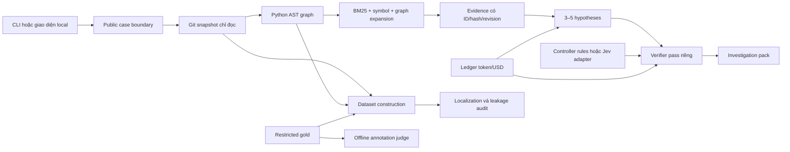

# Kiến trúc IssueIntel

Phase hiện hành (13/10/2026): [Strict DEV](STRICT_DEV_PROTOCOL.md) tách eligibility
khỏi artifact generation. `benchmarks.strict_dev` và `strict_dev_acquisition`
kiểm public provenance, source/reservations, opening query và snapshot-only;
không chạy graph/gold localization/LLM/evaluation. Release V2 bên dưới giữ nguyên
semantics cũ. Phase này chỉ kiểm đúng 400 Main Dev gốc và freeze N ≤ 400.
`main_dev_artifact_routing_v1` có cổng cohort Main Dev đã freeze và pilot trước bulk.

Milestone B: `benchmarks.dev_artifacts` replay/build deterministic graph, public
evidence và nhánh localization riêng; `benchmarks.dev_generation` đăng ký source,
policy và receipt theo stage chỉ trên accepted Main Dev. [DEV_ARTIFACTS.md](DEV_ARTIFACTS.md)
mô tả cổng pilot, stage exceptions, failure/resume và giới hạn nhãn.

## Pipeline chung

`investigation.pipeline.investigate()` là application entry point. Nó nhận case công khai và repository đã chọn revision; không đọc gold, human rationale hoặc nhãn tham chiếu. Dataset preparation dùng cùng `build_snapshot()` và `build_graph()`, rồi mới tạo localization ở nhánh riêng.

Workbench bổ sung intake, follow-up, so sánh, truy xuất lịch sử và checklist qua
shared modules trong `investigation`/`retrieval`. Follow-up có lineage pack hash,
giữ commit và tạo query mới unverified. Related search chỉ tham khảo lịch sử local,
không nhập vào strict inference. `investigation.plan.PlanStore` dùng SQLite local
riêng cho user-reported checks, hash chain và optimistic concurrency; không dùng
PostgreSQL hoặc sửa benchmark receipts. Interface chỉ render và gọi các service.

## Quyền sở hữu của các package

| Package | Trách nhiệm | Ranh giới |
|---|---|---|
| `repository` | Nhận GitHub URL/local Git; đọc Git objects; AST; cache blob có hash | Không checkout, import hoặc chạy test/code của repo đích |
| `retrieval` | BM25/identifier, loại chunk trùng, mở rộng cạnh typed có giới hạn | Điểm liên quan không phải xác suất đúng |
| `investigation` | Hypotheses, controller, critique, investigation pack | Chỉ public evidence; không gold judge |
| `annotations` | Schema, sinh nhãn, synthetic variants, blind review; judge tách riêng | Provenance LLM/synthetic/source-human/human riêng biệt |
| `benchmarks` | Pin/import nguồn; projection; temporal audit; asset/annotation workflow | Gold chỉ ở dataset construction/evaluator; default dev |
| `evaluation` | Metric localization và capability đọc holdout theo release | Cần ủy quyền evaluation mới; file patch là proxy, giữ file ngoài snapshot trong mẫu số |
| `runtime` | Cấu hình, hash, ghi atomic, sổ ngân sách SQLite | Thiếu limit/key/price thì từ chối; không có unlimited ngầm |
| `interfaces` | CLI gọi application code | Không nhét logic truy xuất/gán nhãn vào giao diện |

## Snapshot và provenance

Snapshot chứa commit, tree, Git blob OID, SHA256 raw bytes/canonical text, protocol, cutoff, skipped files và hash toàn snapshot. Cat-file batch đọc các blob trong một tiến trình, giới hạn 10.000 file, 512 KB/file và 25 MB/source snapshot. Symlink, submodule, binary, encoding lỗi và phần vượt giới hạn đều có lý do bỏ qua.

Graph có node file/class/function; cạnh contains/imports/inherits/calls. Quan hệ call tĩnh là suy luận từ syntax, không chứng minh hành vi runtime. Dynamic dispatch và tên mơ hồ giữ unresolved. Graph phải khớp revision/hash snapshot; snapshot được truyền vào pipeline phải khớp case và protocol.

Cache giữ text theo SHA256 trong blob gzip dùng chung; index snapshot và graph nén. Investigation pack chỉ chứa code excerpts và metadata liên quan, không chép toàn repository. Có thể rebuild derived cache từ nguồn, nhưng phải kiểm receipt/inventory trước khi coi một ca hoàn tất; không thay hash mong đợi để che lỗi.

## Temporal và gold isolation

Hai protocol: `benchmark_base` đọc base_commit của upstream và khai báo thời gian chưa xác minh; `issue_time` từ chối nếu không có receipt xác minh đúng revision với `available_at < issue_created_at`. Hash đúng không chứng minh lịch sử đúng. Receipt authenticity thuộc trách nhiệm caller; audit lưu giới hạn này.

Target issue là truy vấn tại thời điểm mở nên có ngoại lệ `<=` cho original title/body. Nội dung API hiện tại và `updated_at` không đủ chứng minh body ban đầu. Human notes, patch, test_patch, test IDs, hints và metadata evaluation không đi vào prompt public. Gold localization chỉ trích file/dòng phía base/symbol từ unified diff; insertion có anchor riêng, added file không bịa pre-patch symbol.

`benchmarks.asof` chuẩn bị receipt lịch sử, còn `asof_assets` replay receipt trước khi xây snapshot `issue_time`. Base nguồn giữ nguyên; selected ancestor phải có ancestry và public availability riêng. Query ban đầu nằm trong overlay có parent/hash, không sửa case nguồn. GitHub opened event và Trac version 0 có adapter riêng. Nhãn người của query nguồn không tự áp dụng cho overlay.

`benchmarks.construction` đăng ký recipe trước call và lưu các stage generation/critique/judge/variants riêng. Hash dependency theo protocol: thay đổi validator lịch sử chặn strict resume; code generation chung chặn cả hai protocol. ZIP source/config của registration giữ hash của lần chạy. Preparation/annotation construction có thể tạo asset/nhãn holdout theo recipe, nhưng không mở evaluation capability, tính metrics hoặc tune model.

`benchmarks.releases` chốt các ca đủ proof và đủ bốn stage, giữ exclusions và archive của recipe. `evaluation.open_test_split` nhận release có hash cùng ủy quyền/purpose mới; capability đọc đúng cohort đã chốt, replay integrity mỗi lần đọc và hết hiệu lực khi rời context. Cổng bootstrap cũ vẫn giữ dữ liệu Live chưa xác minh ở trạng thái bị chặn. Các module này không gọi model hoặc tự chạy metrics.

`benchmarks.cohorts` tạo view cho extension Live có parent/source/selection hashes, tách cases/eligibility/restricted gold. View yêu cầu lựa chọn rõ ràng, không đổi default dev/test loaders hoặc nguồn bootstrap. Historical và annotation builders chỉ nhận namespace được hỗ trợ bởi phiên bản code/recipe tương ứng; không truyền ID ngoài manifest để lách kiểm.

## Controller và verifier

Rule workflow là baseline cố định. `JevController` nhận state cùng allowed actions, chỉ trả enum hợp lệ; hành động khác fallback về rules. Adapter chưa cấu hình remote transport. Code vẫn giữ quyền kiểm ngân sách và thực thi; decision model không tự chạy command.

Verifier kiểm hash/ID trước. Pass LLM riêng kiểm support/counter và trả assessment có citation; đây là critique của cùng model khi dùng cùng provider, không được gọi là kiểm người độc lập. Semantic correctness và causal truth vẫn phân biệt. Khi citation sai, generator chỉ được sửa schema một lần với allowlist; lỗi budget/network không được tự retry.

## Ngân sách và bảo mật

Reservation token/cost trước HTTP được ghi trong SQLite transaction `BEGIN IMMEDIATE`, chống các call đồng thời vượt tổng khi có cap. Tác giả đã cho phép bỏ token/USD cap cho công việc dựng lại cần thiết; explicit flags phải khớp author decision, không suy ra unlimited từ cấu hình thiếu. Usage hợp lệ mới giảm charge từ cận trên; call lỗi/usage thiếu giữ cận. Usage vượt bound hoặc bất nhất khóa ledger để review. Ledger không chứa prompt/secret. Giá có ngày và nguồn, decimal/round-up, giá cũ quá 30 ngày chặn.

Authorization không đi qua redirect; chỉ endpoint Groq cố định. Không retry ngầm, built-in tool hoặc vòng server không kiểm soát. CI chỉ dùng synthetic fixture/mocked transport. PostgreSQL DSN cũ trong .env không được dùng. Artifact/data/secrets đều ignored; demo và review chỉ dùng cục bộ.
