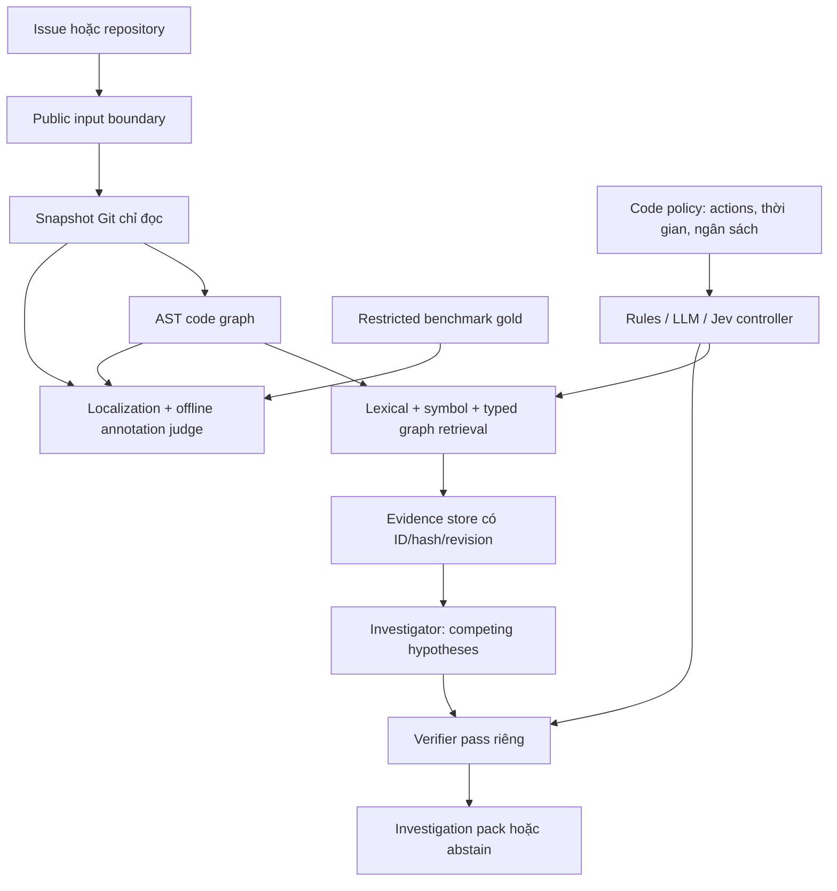

# IssueIntel: Trợ lý điều tra issue dựa trên bằng chứng

**Đề cương gửi giảng viên — phiên bản 4, ngày 12/10/2026**  
**Sinh viên:** [Họ tên — Mã số sinh viên]  
**Giảng viên hướng dẫn:** [Họ tên]  
**Đơn vị:** [Khoa/Bộ môn — Trường]

## 1. Tóm tắt

IssueIntel hỗ trợ lập trình viên tìm hiểu một issue trước khi sửa lỗi: xác định đoạn code liên quan, xây dựng các giả thuyết nguyên nhân, tìm bằng chứng hỗ trợ và phản bác, rồi đề xuất bước kiểm tra tiếp theo. Kết quả là một investigation pack có liên kết về nguồn và phiên bản, phân biệt quan sát trực tiếp với suy luận và những điều chưa xác minh.

Đề tài xây dựng một pipeline chung cho sản phẩm và nghiên cứu: issue → snapshot repository → code graph → truy xuất bằng chứng → giả thuyết cạnh tranh → kiểm chứng → báo cáo. Lõi chỉ đọc mã nguồn, không tự chạy code hoặc sửa repository đích. Jev được giữ trong thiết kế như một decision model chọn bước điều tra từ tập hành động hợp lệ; chương trình chịu trách nhiệm thực thi, kiểm quyền, thời gian và ngân sách.

Dữ liệu nghiên cứu chuyển sang **IssueIntel-Bench**, lấy SWE-bench làm nguồn và bổ sung annotation. Mục tiêu quy mô khoảng 800 task: 500 SWE-bench Verified và khoảng 300 ứng viên SWE-bench Live. Đây là quy mô task nguồn; một task chỉ được coi hoàn chỉnh khi có đủ asset, annotation và các kiểm định được yêu cầu. Không gọi một tập Live là temporal test chỉ dựa trên ngày PR, và không coi nhãn chất lượng task của SWE-bench là kiểm người cho annotation mới.

## 2. Bài toán và mục tiêu

Triệu chứng lỗi có thể được mô tả bằng ngôn ngữ tự nhiên, traceback hoặc ví dụ ngắn. Mã nguồn và kiến thức cần thiết lại phân bố giữa file, symbol, issue cũ, PR, commit và tài liệu. Tìm văn bản tương tự chưa đủ xác định quan hệ kỹ thuật; một câu trả lời có trích dẫn vẫn có thể diễn giải sai nguồn.

Mục tiêu của đề tài:

1. Xây dựng snapshot có revision và provenance để mở lại bằng chứng.
2. Truy xuất code và lần theo quan hệ typed trong repository.
3. Sinh 3–5 giả thuyết phân biệt được, kèm support/counter evidence và falsification test.
4. Có bước kiểm chứng riêng và cơ chế abstain khi chưa đủ căn cứ.
5. Đánh giá chất lượng định vị, grounding, điều phối và chi phí trên giao thức thống nhất.
6. Cung cấp giao diện/CLI local dùng cùng logic với pipeline benchmark.

Khuyến nghị kiểm tra là đầu ra có ích ngay cả khi chưa biết nguyên nhân. Hệ thống không biến một giả thuyết thành kết luận chỉ vì nhắc đúng file trong gold patch.

## 3. Cơ sở nghiên cứu và định hướng kế thừa

| Công trình | Ý tưởng sử dụng trong IssueIntel | Phạm vi |
|---|---|---|
| [LocAgent](https://arxiv.org/abs/2503.09089) | Code graph với file/class/function và cạnh imports/calls/inherits; truy xuất entity và mở rộng graph | Lõi AST graph và typed retrieval |
| [Improving Code Localization with Repository Memory](https://openreview.net/pdf?id=8yjWLJy2eX) | Phân biệt bộ nhớ sự kiện sửa lỗi với ngữ cảnh kiến trúc repository | Roadmap memory có revision và thời gian |
| [AGR](https://link.springer.com/article/10.1007/s10515-026-00640-x) | Kiểm mức đủ bằng chứng, xung đột và abstention trong luồng retrieval/generation | Rubric sufficiency và điều phối bounded |
| [ReProAgent](https://arxiv.org/abs/2607.09123) | Tách định vị, phân tích nguyên nhân, lập kế hoạch kiểm tra và tái hiện lỗi | Bước kiểm tra đề xuất; runtime reproduction thuộc giai đoạn sau |
| [Agentless](https://arxiv.org/abs/2407.01489) | Workflow đơn giản, cố định làm baseline có thể diễn giải | Không mặc định agent động tốt hơn |
| [SWE-bench Verified](https://openai.com/index/introducing-swe-bench-verified/) và [SWE-bench Live](https://github.com/microsoft/SWE-bench-Live) | Task có issue, base revision, patch và test tham chiếu | Nguồn benchmark, gold tách khỏi inference |

Các công trình trên đã bao phủ những phần đáng kể của localization, memory, evidence governance và reproduction. Đề tài **không tuyên bố tổ hợp temporal evidence + hypotheses + counter-evidence + abstention là mới hoàn toàn hoặc là công trình đầu tiên**. Đóng góp dự kiến nằm ở giao thức annotation/audit có thể tái tính và việc đo các thành phần trên cùng pipeline. Tính mới cần được đối chiếu tiếp với related work khi viết paper.

Triển khai tự viết các primitive phù hợp; không fork toàn bộ runtime của các repo tham khảo. Nếu tái sử dụng code sau này, phải kiểm license và ghi nguồn.

## 4. Câu hỏi nghiên cứu

| Mã | Câu hỏi | Thí nghiệm dự kiến |
|---|---|---|
| RQ1 | Code graph và truy xuất xuyên artifact cải thiện định vị bao nhiêu? | Lexical/symbol → +graph → +history/documentation |
| RQ2 | Các giả thuyết cạnh tranh và counter-evidence có giảm nhận định thiếu căn cứ? | Một giả thuyết → nhiều giả thuyết; có/không counter-search và verifier |
| RQ3 | Abstention có giúp hệ thống xử lý thiếu hoặc mâu thuẫn evidence? | Task tự nhiên và controlled variants, báo coverage cùng quality |
| RQ4 | Agent động hoặc Jev có tốt hơn workflow cố định trong cùng ngân sách? | Rules/fixed, LLM controller, Jev controller; giữ công cụ/model/evidence tương đương |
| RQ5 | Chất lượng thay đổi thế nào theo token, chi phí và độ trễ? | Chất lượng–cost–latency frontier, phân tầng repository/độ khó |
| RQ6 | Kết quả có ổn định trên task sau cutoff thật sự? | Cohort Live đã qua audit ngày issue và lịch sử snapshot |

Ưu tiên đầu tiên là localization và grounding trên dev. Temporal test và controller comparison chỉ chạy khi đủ dữ liệu, cấu hình và ủy quyền đánh giá; không dùng holdout để điều chỉnh prompt hoặc chọn model.

## 5. Phạm vi sản phẩm và chức năng

MVP là trợ lý điều tra chỉ đọc chạy local. Đầu vào là GitHub issue URL, repository URL hoặc Git local cùng mô tả issue và revision rõ ràng. Đầu ra JSON/Markdown giữ evidence ID, locator, SHA, provenance, hypotheses, verification và stop reason.

Toàn bộ chức năng đã bàn vẫn được giữ trong lộ trình:

| Mã | Chức năng |
|---|---|
| F01 | Tiếp nhận và phân loại issue, chuẩn hóa intent/triệu chứng/thông tin thiếu |
| F02 | Tìm issue tương tự và ứng viên duplicate, phân biệt giống triệu chứng với đủ căn cứ |
| F03 | Định vị file/hàm/dòng ở đúng snapshot |
| F04 | Điều tra qua issue, PR, commit, code và tài liệu |
| F05 | Kế hoạch và trạng thái điều tra có phiên bản |
| F06 | Jev và lựa chọn bước tiếp theo trong tập hành động hợp lệ |
| F07 | Giả thuyết cạnh tranh và đồ thị bằng chứng |
| F08 | Verifier, counter-evidence và kết thúc có căn cứ |
| F09 | Hỏi thông tin còn thiếu và nhận chỉ dẫn tiếp nối |
| F10 | Checkpoint, resume và tránh lặp công việc đã hoàn tất |
| F11 | Bộ nhớ và ngữ cảnh repository có nguồn/revision |
| F12 | Quick/Deep và định tuyến mức độ khó |
| F13 | Tiến độ, chi phí và hủy tác vụ |
| F14 | Lịch sử, so sánh và điều tra lại theo dữ kiện mới |
| F15 | GitHub bot theo sự kiện/lệnh |
| F16 | Duyệt cụ thể trước thao tác ghi GitHub |
| F17 | Investigation pack và xuất báo cáo có trích dẫn |
| F18 | Trace, token, USD và lỗi có kiểm soát |
| F19 | API và batch với giới hạn đồng thời/ngân sách |
| F20 | Đối chiếu phiên bản/phát hành và tình trạng bản sửa |

Các chức năng này là yêu cầu thiết kế, không phải tuyên bố toàn bộ đã hoàn thành. Lõi hiện thực ưu tiên F03, F07, F08, F10, F17–F19 ở phạm vi dataset/CLI; history cross-artifact, UI nâng cao, bot và write actions phát triển sau. Bot không tự comment/đóng issue nếu chưa có duyệt nội dung và quyền tương ứng.

## 6. Kiến trúc và phân công giữa LLM, Jev, code

**LLM:** đọc issue/evidence, nêu giả thuyết và bước kiểm tra, critique và diễn đạt. Text trong issue/repo được coi là dữ liệu không tin cậy, không phải chỉ thị hệ thống.

**Jev:** chọn quyết định trong enum và tập allowed actions do code cung cấp. Không trực tiếp thực thi shell, vượt budget hoặc tự mở quyền ghi. Adapter có fallback theo luật khi output không hợp lệ; dịch vụ/transport cụ thể cần cấu hình và đánh giá riêng.

**Code:** đọc Git objects, kiểm revision/hash, xây graph, truy xuất, kiểm schema/citations, ghi checkpoint và áp dụng ngân sách. Không dùng LLM thay cho các kiểm tra quyết định được bằng chương trình.

Code được tổ chức thành repository, retrieval, investigation, annotations, benchmarks, evaluation, runtime và interfaces. Không đặt logic tái sử dụng trong scripts, không tạo package trống cho tính năng chưa cần. Lõi dùng Python standard library; Parquet import và kiểm thử là extras.

### 6.1. Evidence và verification

Evidence có type, locator/span, text hash, revision, thời điểm available nếu biết và provenance. BM25 score hoặc graph proximity chỉ đo độ liên quan, không phải xác suất giả thuyết đúng.

Investigator nêu 3–5 hypotheses, mỗi hypothesis có support IDs, counter IDs hoặc not_found, cùng falsification test. Verifier kiểm tính toàn vẹn citation rồi dùng pass riêng để xét ngữ nghĩa. Pass cùng model vẫn có bias chung, không được gọi là kiểm người độc lập. Schema repair tối đa một lần; không tự bịa ID hoặc ánh xạ một citation giả sang nguồn thật.

### 6.2. Snapshot và bộ nhớ

Git bare cache đọc object của revision, không checkout hoặc thực thi repository đích. Snapshot giới hạn file/byte, ghi rõ symlink/submodule/binary/encoding lỗi/phần vượt giới hạn. AST giữ unresolved/ambiguous edges. Blob theo SHA256 dùng chung và metadata nén để giảm lặp giữa các revision.

Memory trong lộ trình lưu sự kiện/summary kèm nguồn và version. Historical memory chỉ được dùng khi có trước mốc query; không đưa patch hoặc lời giải của chính task hiện tại vào evidence.

## 7. IssueIntel-Bench

### 7.1. Task nguồn và split

| Phần | Nguồn | Quy mô nhập hiện tại | Vai trò |
|---|---|---:|---|
| Main dev | SWE-bench Verified | 400 | Phát triển và diagnostic |
| Main holdout | SWE-bench Verified | 100 | Đánh giá chính sau khi đăng ký/được phép |
| Temporal candidates | SWE-bench Live | 300 | Chờ audit đủ điều kiện temporal |

Main giữ đủ 500 task nguồn. Nhóm repository + base_commit và explicit parent không tách giữa dev/test; variant chung split với parent. Mốc temporal dự kiến của gpt-oss là 01/07/2024 UTC, vì model card chỉ nêu June 2024, không nêu ngày chính xác.

Nguồn có full revision, URL, size và SHA256 bất biến. Một ID Live có metadata xung đột được loại cả hai record trước khi chọn cohort. Không cộng full/test/verified/lite của Live vì có overlap.

### 7.2. Bốn lớp annotation

1. **Upstream:** issue, base_commit, gold patch/tests. Case cho inference tách khỏi restricted gold/hints/evaluation metadata.
2. **Build tự động:** source snapshot, graph, patch-derived localization, leakage audit và build receipt. File ngoài snapshot vẫn nằm trong mẫu số localization.
3. **LLM overlay:** hypotheses, support/counter, falsification test và provenance. Có thể dùng offline gold judge để gán nhãn supported/refuted/uncertain tương đối theo tham chiếu; nhãn đó vẫn tự động và causal truth unverified.
4. **Answerability:** ordinal underspecification gốc cùng controlled evidence removal/conflict. Severity 1 không tự động chuyển thành abstain. Synthetic target giữ unreviewed cho đến khi có người kiểm.

Không bắt buộc gán một giả thuyết đúng và một giả thuyết sai khi tham chiếu không đủ xác định. Không tạo counter-evidence giả để hoàn thành mẫu. Đối với phần chưa đủ căn cứ, uncertain/pending là kết quả trung thực.

### 7.3. Temporal protocol và chống leakage

Created_at upstream là ngày PR, không phải ngày issue. PR sau cutoff có thể sửa một issue cũ. Base_commit cũng không chứng minh snapshot tồn tại trước lúc mở issue.

Hai protocol được phân biệt:

- **benchmark_base:** dùng buggy base revision của upstream; ghi thời gian chưa xác minh.
- **issue_time:** cần receipt đúng revision, nguồn public availability và available_at **nhỏ hơn** issue_created_at. Title/body của chính issue tại lúc mở là query, với ngoại lệ bằng thời điểm tạo; nội dung chỉnh sửa về sau không được mặc định hợp lệ.

Tác giả chọn dùng mô tả ban đầu cho protocol strict. Mô tả này được lưu thành overlay có parent case và hash, giữ nguyên SWE-bench cùng gold. Main Django dùng Trac version 0; GitHub dùng opened event. Nhãn chất lượng nguồn vẫn thuộc phạm vi mô tả SWE-bench gốc, không xác nhận query lịch sử mới. Snapshot có thể là ancestor đã chứng minh public trước lúc mở issue; giữ riêng revision này và base của upstream.

Audit kiểm mọi issue liên kết, original body provenance và snapshot availability. Git author/committer dates và API updated_at riêng lẻ không đủ. Case không đủ proof ở trạng thái pending; issue trước cutoff bị loại khỏi temporal eligibility. Temporal cohort chỉ là biện pháp giảm rủi ro contamination, không chứng minh model chưa thấy dữ liệu trong training/fine-tuning.

### 7.4. Người kiểm và giới hạn

SWE-bench Verified có kiểm task gốc; nguồn annotation nhập được 500 ordinal clarity labels. Các nhãn này không xác nhận hypotheses, counter-evidence hoặc synthetic variants do IssueIntel thêm.

Tác giả hiện chọn dựa vào human check của nguồn, chưa bố trí hai reviewer cho overlay. Vì vậy proposal không tuyên bố đã có independent human validation hoặc inter-annotator agreement mới. Pipeline vẫn chuẩn bị blind review và scorer để bổ sung khi có người; không đổi nhãn agent thành nhãn human.

## 8. Đánh giá và tiêu chí nghiệm thu

**Localization:** Recall@K, Precision@K, MRR, all-files@K; báo riêng unavailable files và mức bao phủ snapshot. Line/function targets từ patch là proxy, không phải nhãn nguyên nhân đúng tuyệt đối.

**Grounding:** citation integrity, semantic support theo reviewer/critic, tỷ lệ unsupported, counter-evidence coverage. ID tồn tại không đủ tính semantic correctness.

**Hypotheses/abstention:** reference-relative automatic labels báo riêng human labels; đo coverage/quality và controlled robustness, không đồng nhất ordinal clarity với answerability.

**System:** latency, số tool/model calls, token vào/ra, USD, schema repair, rate/network failures và khả năng resume.

**Ablation:** keyword/symbol, +graph, fixed workflow, +verifier, +counter-search, controlled variants; memory và Jev thêm khi có adapter/nguồn lực. Không suy ra kết quả tốt từ paper của hệ thống khác.

Một benchmark release hoàn chỉnh phải có đủ task assets/annotations, source/recipe manifests, kiểm integrity, rõ cohort exclusions và annotation status. Evaluation holdout cần ủy quyền riêng qua capability gate; development không tune trên holdout. Kết quả dev hoặc metadata audit không được mô tả là production/test performance.

## 9. Nguồn lực và lộ trình

Mô hình tác giả chọn là **openai/gpt-oss-120b trên Groq**, Tác giả ban đầu đặt 200.000 token/ngày và 2 USD/tháng, sau đó **đã bỏ cả hai trần cho công việc dựng lại cần thiết ngày 12/10/2026**; quyết định được lưu nguyên văn trong configs/author_decisions.json. Không đặt thêm request/day hoặc USD/day khi tác giả chưa chọn. Sổ reservation dùng UTC calendar, lưu qua restart và ghi cận/usage cho mỗi call; nếu có cap thì kiểm tổng trước khi gọi. Unlimited chỉ được bật bằng quyết định tác giả rõ ràng; thiếu limit không đủ để bật. Giá lấy từ tài liệu Groq có ngày; thiếu giá/key, hoặc thiếu cả limit lẫn quyết định unlimited hợp lệ thì chặn.

API errors và usage thiếu giữ cận trên để tránh vượt chi. Quota/rate limit/ZDR của tài khoản chưa được coi đã xác minh. Dữ liệu lưu local; việc gọi Groq gửi issue/code excerpts đã chọn đến provider. Jev hoặc dịch vụ khác cần cấu hình/ngân sách riêng.

Lộ trình theo cổng nghiệm thu, không bịa số giờ mỗi tuần:

1. Hoàn thiện import, snapshot/graph/localization và audit.
2. Chạy pilot annotation dev, xử lý schema/quality/cost, mở rộng trong budget.
3. Hoàn thiện temporal receipts/cohort và bổ sung người kiểm nếu có.
4. Đăng ký evaluation, so sánh baseline/ablation và viết báo cáo.
5. Hoàn thiện giao diện local, history/memory, Jev; bot/write actions sau cùng.

Quota thực của provider, context, dữ liệu lịch sử và chất lượng nhãn vẫn có thể khiến annotation cần nhiều phiên. Không giảm tiêu chí hoàn thành để báo đủ 800 nhãn; chi phí thực và trạng thái phải được ghi lại.

## 10. Đóng góp dự kiến và rủi ro

Đóng góp dự kiến gồm pipeline dùng chung, annotation/provenance có schema, temporal leakage audit, investigation pack kiểm được và thí nghiệm có baseline phù hợp. Paper chỉ công bố điều dữ liệu và phép đo thật sự hỗ trợ.

Rủi ro chính: patch-derived targets không phải causal truth; source issue có thể đã chỉnh sửa; strict historical availability khó tái dựng; cùng LLM sinh và xét nhãn có bias; static Python graph không bao phủ runtime/đa ngôn ngữ; ngân sách/quota giới hạn annotation. Những rủi ro này cần được báo cáo cùng mức hoàn thành và exclusions.

Bản đề cương này thay thế phạm vi dữ liệu pytest ban đầu. Kết quả lịch sử được lưu trong gói phục hồi ngoài project, không trộn thành bằng chứng cho SWE-bench benchmark mới.

## Tài liệu kỹ thuật của project

- README.md: cài đặt và lệnh chạy.
- docs/ARCHITECTURE.md: package boundaries, provenance, controller và budget.
- docs/DATA_PROTOCOL.md: nguồn/split, temporal gate và data release.
- docs/LABELING_RUBRIC.md: hypotheses, answerability, blind review.
- data/manifests/: hash/count nguồn thực tế; data và secret giữ private.

